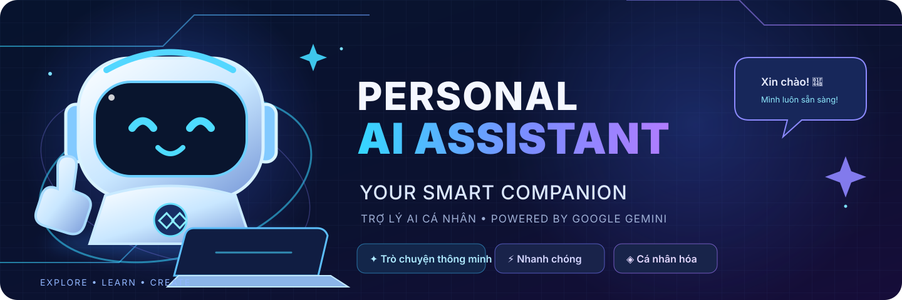
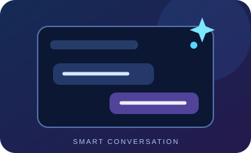
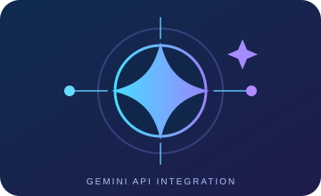
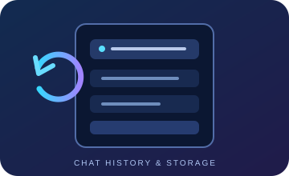
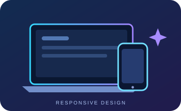
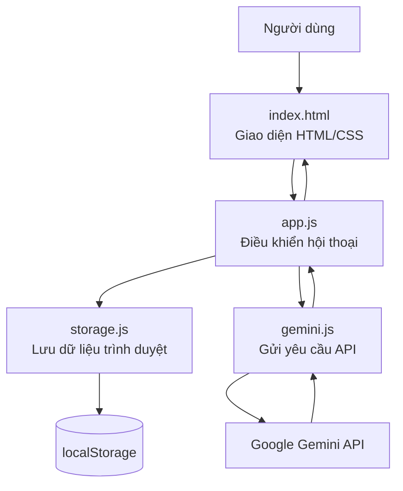

<p align="center">
  
</p>

# Personal AI Assistant – Trợ lý AI cá nhân

<p align="center">
  <strong>Trợ lý AI trên nền tảng web, hỗ trợ trò chuyện và giải đáp bằng Google Gemini.</strong>
</p>

<p align="center">
  <a href="https://thanhdanh-a.github.io/WWWWW/">🌐 Trải nghiệm website</a> ·
  <a href="https://github.com/ThanhDanh-A/WWWWW">📦 Mã nguồn GitHub</a> ·
  <a href="https://aistudio.google.com/apikey">🔑 Tạo Gemini API Key</a>
</p>

<p align="center">
  <a href="docs/ARCHITECTURE.md">Kiến trúc</a> ·
  <a href="docs/DEVELOPMENT.md">Hướng dẫn phát triển</a> ·
  <a href="docs/TESTING.md">Kế hoạch kiểm thử</a>
</p>

<p align="center">
  
  
  
  
  
</p>

---

## 1. Giới thiệu

**Personal AI Assistant** là dự án website trợ lý AI cá nhân được xây dựng bằng HTML, CSS và JavaScript. Ứng dụng sử dụng Google Gemini API để tiếp nhận câu hỏi, xử lý nội dung và trả về câu trả lời trực tiếp trên giao diện trò chuyện.

Dự án hướng đến việc thực hành phát triển ứng dụng web, tích hợp API bên ngoài, quản lý dữ liệu ở trình duyệt và triển khai sản phẩm bằng GitHub Pages.

## 2. Mục tiêu

- Xây dựng giao diện chatbot thân thiện, dễ sử dụng.
- Tìm hiểu cách gửi yêu cầu HTTP đến Google Gemini API.
- Thực hành JavaScript hiện đại và chia mã nguồn thành các module.
- Lưu lịch sử trò chuyện trên trình duyệt.
- Thực hành quản lý mã nguồn bằng GitHub và triển khai website tĩnh.

## 3. Chức năng chính

| Chức năng | Mô tả |
|---|---|
| Trò chuyện với AI | Gửi câu hỏi và nhận câu trả lời từ Google Gemini |
| Câu hỏi gợi ý | Có sẵn gợi ý kể chuyện, viết lời chúc, tâm sự và soạn tin nhắn |
| Quản lý API Key | Người dùng tự nhập, lưu, kiểm tra kết nối hoặc xóa API Key trên trình duyệt |
| Lịch sử hội thoại | Tạo, mở và xóa các cuộc trò chuyện |
| Lưu dữ liệu cục bộ | Lịch sử và API Key được lưu bằng localStorage |
| Định dạng câu trả lời | Hiển thị nội dung Markdown, danh sách và đoạn mã |
| Sao chép câu trả lời | Sao chép nội dung phản hồi của AI |
| Giao diện responsive | Hỗ trợ bố cục máy tính và thiết bị di động |
| Xử lý lỗi | Hiển thị thông báo khi API Key, mạng hoặc dịch vụ Gemini gặp vấn đề |
| Model dự phòng | Thử model Gemini Flash-Lite trước, sau đó chuyển sang Flash khi cần |

## Góc nhìn nhanh về dự án

Các hình minh họa dưới đây mô tả những nhóm chức năng chính của ứng dụng. Đây là hình minh họa chức năng, không phải ảnh chụp màn hình kết quả chạy thực tế.

<table>
  <tr>
    <td align="center" width="50%">
      
      <strong>Trò chuyện với AI</strong><br>
      <sub>Gửi câu hỏi và nhận phản hồi từ Gemini</sub>
    </td>
    <td align="center" width="50%">
      
      <strong>Kết nối Gemini API</strong><br>
      <sub>Gửi yêu cầu và nhận dữ liệu qua API</sub>
    </td>
  </tr>
  <tr>
    <td align="center" width="50%">
      
      <strong>Lịch sử hội thoại</strong><br>
      <sub>Lưu và mở lại các cuộc trò chuyện</sub>
    </td>
    <td align="center" width="50%">
      
      <strong>Thiết kế responsive</strong><br>
      <sub>Thích ứng với màn hình máy tính và điện thoại</sub>
    </td>
  </tr>
</table>

---

## 4. Công nghệ sử dụng

| Công nghệ | Vai trò |
|---|---|
| HTML5 | Xây dựng cấu trúc trang web |
| CSS3 | Thiết kế giao diện, hiệu ứng và responsive |
| JavaScript ES Modules | Xử lý tương tác và chia nhỏ chức năng |
| Google Gemini API | Tạo câu trả lời bằng trí tuệ nhân tạo |
| Marked | Chuyển đổi nội dung Markdown |
| DOMPurify | Làm sạch HTML trước khi hiển thị |
| localStorage | Lưu API Key và lịch sử trò chuyện trên thiết bị |
| GitHub | Quản lý mã nguồn |
| GitHub Pages | Triển khai website tĩnh |

## 5. Cấu trúc thư mục

```text
WWWWW/
├── index.html
├── README.md
├── .gitignore
├── assets/
│   ├── css/
│   │   └── style.css
│   ├── js/
│   │   ├── app.js
│   │   ├── gemini.js
│   │   └── storage.js
│   └── images/
│       ├── logo.svg
│       ├── ai-mascot.svg
│       ├── github-banner.svg
│       └── features/
│           ├── chat.svg
│           ├── gemini.svg
│           ├── history.svg
│           └── responsive.svg
├── docs/
│   ├── ARCHITECTURE.md
│   ├── DEVELOPMENT.md
│   └── TESTING.md
├── screenshots/
│   └── README.md
└── archive/
    └── original/
        ├── index.html
        ├── README.md
        └── README
```

**Vai trò các tệp chính:**

- `index.html`: trang chính và các thành phần giao diện.
- `assets/css/style.css`: màu sắc, bố cục, hiệu ứng và giao diện trên điện thoại.
- `assets/js/app.js`: điều khiển giao diện, gửi tin nhắn và quản lý hội thoại.
- `assets/js/gemini.js`: gọi Gemini API, xử lý phản hồi và model dự phòng.
- `assets/js/storage.js`: đọc và ghi API Key, lịch sử hội thoại vào localStorage.
- `assets/images/logo.svg`: biểu tượng của dự án.
- `assets/images/ai-mascot.svg`: hình minh họa robot AI ở màn hình chào mừng.
- `assets/images/github-banner.svg`: banner giới thiệu dự án ở đầu README.
- `assets/images/features/`: các hình minh họa cho nhóm tính năng trong README.
- `docs/ARCHITECTURE.md`: sơ đồ và giải thích luồng dữ liệu.
- `docs/DEVELOPMENT.md`: hướng dẫn chạy và phát triển trên máy tính.
- `docs/TESTING.md`: bảng tình huống kiểm thử và cách ghi nhận kết quả.
- `screenshots/`: nơi lưu ảnh chụp màn hình thật sau khi chạy sản phẩm.
- `archive/original/`: bản sao các tệp gốc trước khi nâng cấp, được giữ lại để tham khảo và khôi phục.

## 5.1. Sơ đồ hoạt động

Sơ đồ dưới đây mô tả luồng xử lý chính của ứng dụng:



## 6. Hướng dẫn sử dụng

### Bước 1. Mở website

Truy cập [Personal AI Assistant](https://thanhdanh-a.github.io/WWWWW/).

### Bước 2. Tạo Gemini API Key

1. Mở [Google AI Studio – API Keys](https://aistudio.google.com/apikey).
2. Đăng nhập tài khoản Google.
3. Tạo API Key theo hướng dẫn của Google. Theo tài liệu hiện hành, key tạo mới trong AI Studio mặc định dùng loại authorization key từ ngày 28/05/2026; nếu key cũ không dùng được, kiểm tra trạng thái và giới hạn key theo hướng dẫn Google.
4. Sao chép khóa vừa tạo.

### Bước 3. Kết nối API Key

1. Tại thanh bên trái của website, tìm mục **Kết nối Gemini**.
2. Dán API Key vào ô nhập.
3. Nhấn **Lưu API Key** để lưu khóa trên trình duyệt hiện tại.
4. Nhấn **Kiểm tra kết nối** để gửi một yêu cầu thử đến Gemini.
5. Chỉ khi Gemini phản hồi thành công, giao diện mới báo đã kết nối. Trạng thái “đã lưu” không đồng nghĩa khóa đã được xác thực.

### Bước 4. Trò chuyện

- Nhập câu hỏi vào khung tin nhắn và nhấn **Gửi tin nhắn**.
- Nhấn Enter để gửi; dùng Shift + Enter để xuống dòng.
- Có thể chọn một trong các thẻ gợi ý ở màn hình bắt đầu.
- Nhấn **Cuộc trò chuyện mới** để bắt đầu phiên khác.
- Chọn cuộc trò chuyện ở thanh bên để mở lại lịch sử.
- Dùng nút **Sao chép** bên dưới câu trả lời để sao chép nội dung.

### Bước 5. Quản lý API Key

- Nhập khóa mới và nhấn **Lưu API Key** để thay khóa đang dùng.
- Nhấn **Xóa** để xóa khóa đã lưu khỏi trình duyệt hiện tại.

## 7. Chạy dự án trên máy tính

Dự án không yêu cầu cài đặt framework hoặc công cụ build.

1. Tải repository bằng nút **Code → Download ZIP**, sau đó giải nén.
2. Mở thư mục gốc dự án trong VS Code (thư mục có file `index.html`).
3. Mở Terminal tại thư mục gốc và chạy `py -m http.server 5500` trên Windows hoặc `python3 -m http.server 5500` trên macOS/Linux.
4. Mở `http://localhost:5500` trong trình duyệt. Có thể dùng Live Server thay thế; extension này không bắt buộc.
5. Nhập API Key trong giao diện, lưu và kiểm tra kết nối trước khi trò chuyện.

> Lưu ý: Nên chạy qua localhost hoặc HTTPS thay vì mở trực tiếp bằng đường dẫn file. JavaScript ES Modules có thể bị trình duyệt chặn khi mở bằng `file://`.

## 8. Triển khai bằng GitHub Pages

1. Đưa mã nguồn lên repository GitHub.
2. Mở **Settings → Pages**.
3. Trong phần Build and deployment, chọn **Deploy from a branch**.
4. Chọn nhánh triển khai và thư mục `/(root)`.
5. Nhấn **Save** và chờ GitHub Pages hoàn tất.
6. Truy cập website tại đường dẫn được GitHub Pages cung cấp.

Đường dẫn dự án hiện tại: https://thanhdanh-a.github.io/WWWWW/

Nếu website chưa cập nhật ngay, hãy chờ quá trình triển khai hoàn tất và tải lại trang.

## 9. API và chi phí

Ứng dụng gọi Gemini Developer API trực tiếp từ trình duyệt. Mã nguồn hiện ưu tiên hai model:

- `gemini-3.5-flash-lite`
- `gemini-3.8-flash` (model dự phòng)

Ứng dụng chỉ gửi `maxOutputTokens` trong cấu hình tạo nội dung; không tự đặt `temperature` hoặc `topP`, phù hợp khuyến nghị cho các model Gemini 3.x. Xem [ghi chú Gemini 3.5 Flash](https://ai.google.dev/gemini-api/docs/generate-content/whats-new-gemini-3.5).

Google có cung cấp cấp miễn phí cho một số model và hạn mức sử dụng. Khả năng truy cập, giới hạn tốc độ và điều kiện sử dụng có thể thay đổi theo model, tài khoản và khu vực. Hãy xem [bảng giá Gemini API](https://ai.google.dev/gemini-api/docs/pricing) trước khi sử dụng. Dự án không tự động đăng ký gói trả phí hoặc bật thanh toán.

## 10. Lưu ý bảo mật và quyền riêng tư

- **Không đưa API Key vào mã nguồn, README, ảnh chụp màn hình hoặc commit Git.**
- API Key được lưu trong localStorage của trình duyệt và được gửi đến Google qua header HTTPS `x-goog-api-key`, không ghép vào URL.
- Vì đây là ứng dụng chạy hoàn toàn ở phía trình duyệt, người dùng có quyền truy cập thiết bị và DevTools vẫn có thể xem hoặc sử dụng khóa. Cách này phù hợp cho dự án học tập và trải nghiệm cá nhân, **không phải cách bảo vệ khóa cho ứng dụng công khai nhiều người dùng**.
- Không sử dụng API Key cá nhân trên máy tính công cộng. Xóa khóa khỏi trình duyệt khi không còn sử dụng.
- Nếu Google AI Studio hoặc Google Cloud hỗ trợ, hãy giới hạn API Key theo website và API cần dùng; theo dõi hạn mức sử dụng.
- Không nhập thông tin cá nhân nhạy cảm hoặc nội dung bí mật vào chatbot.
- Theo chính sách cấp miễn phí của Google, dữ liệu gửi đến một số dịch vụ/model có thể được dùng để cải thiện sản phẩm. Hãy đọc [điều khoản và chính sách dữ liệu của Gemini API](https://ai.google.dev/gemini-api/terms) trước khi gửi dữ liệu riêng tư.
- Nếu phát triển thành sản phẩm công khai thực tế, nên chuyển việc gọi Gemini API sang backend do mình kiểm soát để giữ API Key ở phía máy chủ.

## 11. Kiểm thử

Bảng kiểm thử chi tiết, kết quả mong đợi và trạng thái thực hiện được ghi trong [docs/TESTING.md](docs/TESTING.md). Các ca kiểm thử chỉ được đánh dấu PASS sau khi đã chạy thực tế trên trình duyệt.

## 12. Tài liệu dự án

- [Sơ đồ kiến trúc hệ thống](docs/ARCHITECTURE.md)
- [Hướng dẫn phát triển và chạy cục bộ](docs/DEVELOPMENT.md)
- [Kế hoạch và bảng kiểm thử](docs/TESTING.md)
- [Nơi lưu ảnh chụp màn hình thực tế](screenshots/README.md)

## 13. Hướng phát triển

- Bổ sung tùy chọn giao diện sáng/tối.
- Cho phép đổi tên cuộc trò chuyện.
- Thêm xuất và nhập lịch sử hội thoại.
- Bổ sung tùy chọn model trong phần cài đặt.
- Nâng cao khả năng truy cập và hỗ trợ bàn phím.
- Xây dựng backend riêng nếu triển khai cho nhiều người dùng.

## 14. Tác giả

**ThanhDanh-A**

- GitHub: [@ThanhDanh-A](https://github.com/ThanhDanh-A)
- Repository: [WWWWW](https://github.com/ThanhDanh-A/WWWWW)
- Website: [Personal AI Assistant](https://thanhdanh-a.github.io/WWWWW/)

## 15. Ghi chú dự án

Dự án được xây dựng với mục đích học tập và thực hành phát triển ứng dụng web, tích hợp API và triển khai sản phẩm trên GitHub Pages.

Thư mục `archive/original/` lưu lại phiên bản gốc trước khi nâng cấp. Những thay đổi mới được thực hiện trên nhánh phát triển riêng để có thể kiểm tra trước khi đưa vào nhánh chính.

---

<p align="center"><strong>Personal AI Assistant – Your smart companion.</strong></p>
