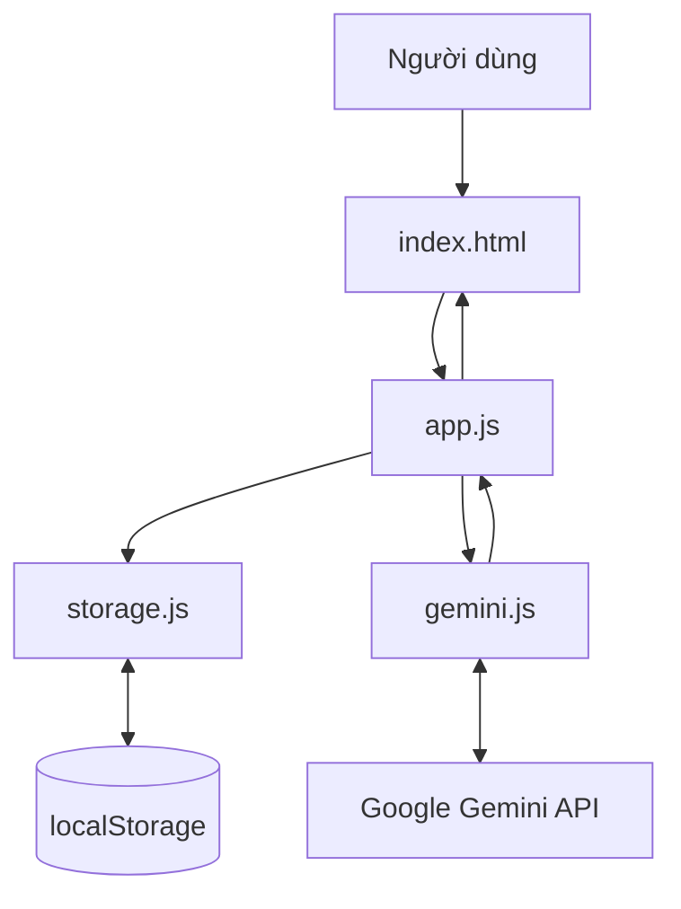

# Kiến trúc hệ thống

## 1. Tổng quan

Personal AI Assistant là ứng dụng web tĩnh, chạy phần giao diện trên trình duyệt. Ứng dụng gọi trực tiếp Google Gemini Developer API để tạo câu trả lời. Không có máy chủ backend riêng trong phiên bản học tập này.

## 2. Sơ đồ luồng dữ liệu

## 3. Vai trò từng thành phần

| Thành phần | Trách nhiệm |
|---|---|
| `index.html` | Khung giao diện, vùng nhập API Key, lịch sử, khung chat và câu hỏi gợi ý |
| `assets/css/style.css` | Màu sắc, bố cục, hiệu ứng, trạng thái và giao diện thích ứng |
| `assets/js/app.js` | Nhận thao tác người dùng, điều khiển hội thoại, cập nhật giao diện và trạng thái kết nối |
| `assets/js/gemini.js` | Gửi yêu cầu HTTP đến Gemini, kiểm tra kết nối, xử lý phản hồi, timeout và model dự phòng |
| `assets/js/storage.js` | Lưu/đọc API Key và lịch sử hội thoại trong localStorage |
| `assets/images/` | Logo, hình minh họa ứng dụng và banner README |

## 4. Luồng trò chuyện

1. Người dùng nhập API Key và chọn **Kiểm tra kết nối**.
2. `app.js` gọi `testConnection()` trong `gemini.js`.
3. `gemini.js` gửi một yêu cầu ngắn đến model chính; nếu gặp lỗi phù hợp, ứng dụng thử model dự phòng.
4. Khi nhận phản hồi hợp lệ, `app.js` lưu API Key vào localStorage và cập nhật trạng thái kết nối.
5. Khi người dùng gửi câu hỏi, `app.js` thêm câu hỏi vào lịch sử, gọi `generateReply()` và hiển thị câu trả lời.
6. `storage.js` lưu lịch sử để người dùng có thể mở lại sau khi tải lại trang.

## 5. Dữ liệu được lưu ở đâu?

- API Key: localStorage của trình duyệt, theo khóa `personal_ai_gemini_api_key`.
- Tương thích bản cũ: khóa `gemini_api_key` được đọc và di chuyển sang tên mới khi cần.
- Lịch sử: localStorage theo khóa `personal_ai_conversations`.
- Dữ liệu không được đồng bộ giữa các trình duyệt hoặc thiết bị.

## 6. Ghi chú về phiên bản API

Phiên bản hiện tại dùng endpoint Generate Content API (`generateContent`), được tài liệu Google đánh dấu là Legacy. Cách này được giữ lại để bảo toàn luồng chat hiện có. Khi có thời gian kiểm thử và nâng cấp riêng, có thể đánh giá việc chuyển sang Interactions API theo hướng dẫn di chuyển chính thức của Google.

## 7. Giới hạn và bảo mật

Ứng dụng gọi Gemini API trực tiếp từ trình duyệt. Vì vậy, người có quyền truy cập thiết bị hoặc công cụ dành cho nhà phát triển của trình duyệt có thể tìm thấy API Key đã lưu. Không dùng khóa trên máy tính công cộng, không commit khóa lên GitHub và không xem phiên bản frontend này là kiến trúc an toàn cho dịch vụ nhiều người dùng.

Nếu phát triển thành sản phẩm công khai, cần chuyển việc gọi Gemini API sang backend do chủ dự án kiểm soát, lưu bí mật ở phía máy chủ và bổ sung kiểm soát truy cập/hạn mức.
